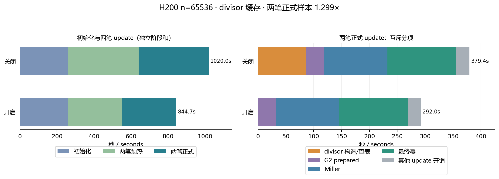

# H200 作业1159：分阶段用时与优化效果 / Phase timing and optimization report

日期 / Date:2026-10-23；终态观察时间 / terminal observed:2026-10-23T16:19:12.557948+08:00。

## 结论 / Result

作业1159通过终态、原始事件、本地/远端审计和资源验收，状态 COMPLETED/0:0。n=65536 的两笔正式 update 合计 **379.445030→292.006491秒**，关闭/开启比值 **1.299440×**，本次样本耗时降低 **23.04%**。这里只比较已启用 R5 完整优化组合后的 divisor 开关，不是原始未优化实现的对照。

Job1159 passed terminal, raw-event, local/remote and resource acceptance with COMPLETED/0:0. The two measured n=65536 updates total **379.445030→292.006491s**: an off/on sample ratio of **1.299440×** and **23.04%** lower sampled time. Both routes already enable the R5 full optimization bundle; only the full-domain divisor flag changes.

调度器记录整个作业用时 **00:32:04**；探针完整进程墙钟 **1906.024秒**，runner 墙钟 **1923.961秒**，编译命令墙钟 **17.249秒**。完整作业包含共享 setup、两路初始化、8笔 update、外部 Reference、校准和最终 CPU dense 对照，不能当成单笔 update 的耗时。

Scheduler runtime is **00:32:04**; probe-process wall time is **1906.024s**, runner wall time **1923.961s**, and build-command wall time **17.249s**. The job includes shared setup, two initializations, eight updates, external Reference checks, calibration and the final CPU dense oracle. This is not single-update latency.

探针完整墙钟扣除共享setup、两路初始化、全部update、外部Reference与最终CPU dense后，剩余未分项开销约 **1.062360秒**，包含未独立计时的校准、对象创建和输出等，不能全部归因于校准。

After subtracting shared setup, initializations, all updates, external Reference and the final CPU dense oracle, approximately **1.062360s** of probe wall time remains unattributed. It includes unclocked calibration, object creation and output; it cannot all be attributed to calibration.

## 各阶段用时 / Phase timings

| 阶段 / Phase | 关闭全域表 / Off (s) | 开启全域表 / On (s) |
| --- | --- | --- |
| 共享参数 setup / shared setup | 14.981672 | 14.981672 |
| Session 初始化 / initialization | 261.002066 | 260.695464 |
| 其中 divisor 构造（已含于初始化） / included construction | 不单独记录 / not separately timed | 21.395530 |
| 两笔预热 update / two warmups | 379.508143 | 291.999133 |
| 两笔正式 update / two measured updates | 379.445030 | 292.006491 |
| 正式单笔均值，仅2笔 / mean of2 samples | 189.722515 | 146.003245 |
| 四笔 update 合计 / all four updates | 758.953173 | 584.005624 |
| setup+初始化+四笔 update 阶段和 / route phase sum | 1034.936910 | 859.682760 |
| 该路外部 Reference 总计 / external Reference | 0.650573 | 0.648985 |

阶段和只是表中若干独立计时的算术和，不是独立测得的端到端墙钟。实际进程只执行一次共享 setup；分别估计每路阶段和时各列引用同一个 setup 值。divisor 构造已经包含在 On 初始化内，不再相加。CPU dense oracle 单独用时 **24.024077秒**。校准记录 host/device 中位数，没有记录整个校准函数的独立墙钟，不能伪造该项秒数。

Route phase sums are arithmetic sums, not independently measured end-to-end wall times. The process runs shared setup once; each route sum references that value. Divisor construction is already inside On initialization. The final CPU dense oracle takes **24.024077s**. Calibration records primitive host/device medians but no independent wall clock for the whole calibration function.

| step | 用途 / Purpose | Off (s) | On (s) | Off/on |
| --- | --- | --- | --- | --- |
| 0 | 预热 / warmup | 189.651927 | 145.968152 | 1.299269 |
| 1 | 预热 / warmup | 189.856217 | 146.030982 | 1.300109 |
| 2 | 正式 / measured | 189.775783 | 146.044194 | 1.299441 |
| 3 | 正式 / measured | 189.669247 | 145.962297 | 1.299440 |

前2笔仅预热，后2笔正式计时。step0/2更新乘法输入8个根，step1/3更新加法输入4个根，每笔均为16个实际 wire 变更。正式单笔均值只有这两种输入各一个样本，不代表稳定分位数或统计显著性。

The first two updates warm up; the last two are measured. Steps0/2 edit eight multiplication-input roots; steps1/3 edit four addition-input roots, each with16 actual wire changes. The mean covers one sample of each shape and establishes no stable percentile or significance.

## 正式计时的内部拆分 / Measured-update breakdown

以下均为两笔正式 update 的合计。层级为 update → preparation → rebuild → cache_check → cache子项。不同层级不能相加。

All following values sum the two measured updates. The hierarchy is update → preparation → rebuild → cache_check → cache children; do not add ancestors to descendants.

| update 外层 / Outer update | Off (s) | On (s) |
| --- | --- | --- |
| 输入归一化 / normalization | 0.000017 | 0.000020 |
| 约束检查 / constraints | 0.000012 | 0.000009 |
| 准备阶段 / preparation | 379.420365 | 291.983383 |
| 发布结果 / publication | 0.017769 | 0.017731 |
| 其他外层开销 / other outer overhead | 0.006866 | 0.005348 |

| preparation 内部 / Preparation child | Off (s) | On (s) |
| --- | --- | --- |
| 前台线性字段 / live linear fields | 0.095150 | 0.095224 |
| 前台 delta proof | 0.000000 | 0.000000 |
| 重基 / rebase | 0.141662 | 0.141419 |
| 重建合计 / rebuilding total | 379.173528 | 291.737736 |
| 其他准备开销 / other preparation overhead | 0.010025 | 0.009005 |

| 重建内部阶段 / Rebuild child | Off (s) | On (s) |
| --- | --- | --- |
| 物化 / materialize | 0.059821 | 0.060533 |
| 线性 MSM / linear MSM | 0.733367 | 0.733502 |
| Fr 变换 / Fr transform | 2.679142 | 2.720726 |
| G1 变换 / G1 transform | 11.048412 | 11.065152 |
| 多项式 / polynomial | 2.659697 | 2.659698 |
| 内存操作 / memory | 0.076853 | 0.076687 |
| 缓存校验 / cache check | 361.774067 | 274.279294 |
| 收尾 / finish | 0.142168 | 0.142145 |

| cache_check 内部阶段 / Cache child | Off (s) | On (s) |
| --- | --- | --- |
| 读回点 / point readback | 1.252117 | 1.208798 |
| G1 差分 / G1 difference | 4.076098 | 4.052614 |
| G2 divisor 构造或查表 / construction or lookup | 86.484197 | 0.058468 |
| G2 prepared | 32.313650 | 32.095487 |
| Miller | 113.588012 | 113.378276 |
| 最终幂 / final exponentiation | 123.832743 | 123.289703 |
| undo 存储 / undo store | 0.047824 | 0.025735 |
| 未变缓存拷贝 / unchanged copy | 0.009550 | 0.009428 |
| 未分配到上述子项的校验开销 / remaining cache overhead | 0.169877 | 0.160784 |

On 路线的 cache_check 仍占 update 的 **93.93%**，其中 Miller+最终幂合计占整个 update 的 **81.05%**。本轮消除了重复 divisor 构造，独立方程、prepared、Miller 与最终幂并未跳过。代码精简主要降低维护成本；后续运行时间优化应依据这份实测瓶颈拆分评估。

On-route cache_check still occupies **93.93%** of update wall time; Miller plus final exponentiation occupy **81.05%**. This change removes repeated divisor construction without skipping independent equations, preparation, Miller loops or final exponentiation. Code consolidation primarily reduces maintenance cost; runtime work should be evaluated against these measured bottlenecks.

## 正确性、命中与资源 / Correctness, actual hits and resources

每路初始196,608条方程；每笔完整 update 保留131,072条独立方程、131,072次Miller、131,072次最终幂、262,144个pairing terms。On 每笔真实查表130,944次、formed=0；Off 构造130,944个divisor。On 仅初始化构造65,536项，初始检查hits=65,536/formed=0。所有8笔 update 完成付费重建、通过各自kQ配额并立即完成swap，没有pending/restart；配对proof/witness及算术计数相同，每步Reference通过，最终anchor与CPU dense一致。驻留缓冲没有随update增长。

Initialization retains196,608 equations per route. Each complete update retains131,072 independent equations, Miller calls and final exponentiations, plus262,144 pairing terms. On records130,944 real table hits and zero divisor formations per update; Off forms130,944. On constructs65,536 entries once, with initial hits65,536/formed0. All eight updates complete paid rebuilds within their own kQ allowances and swap with no pending/restart. Paired proof/witness and arithmetic counts agree; every Reference check and the final CPU dense anchor pass. Resident buffers do not grow across updates.

| 指标 / Metric | 观测 / Observation |
| --- | --- |
| 主机 RSS 采样最大 / maximum sampled RSS | 1,551,306,752 bytes (1.445 GiB) |
| 进程 VmHWM 最大观测 / maximum observed VmHWM | 1,665,712,128 bytes (1.551 GiB) |
| GPU 进程显存采样最大 / maximum sampled process VRAM | 2,518,679,552 bytes (2.346 GiB) |
| 采样 / samples | 380 × nominal5s; max gap5.027s |
| 遥测错误 / telemetry errors | 0 |
| 每 owner 配额 / quota per owner | 2,147,483,648 bytes |
| Off / On owner 计划上界 / planned upper | 1,347,055,360 / 1,358,200,944 bytes |
| 全域表实际类型/容量常驻 / table retained capacity | 11,010,416 bytes |
| 全域表新增主机 envelope / extra host envelope | 11,145,584 bytes |
| 每 owner undo / undo per owner | 134,217,728 bytes |

两个 owner 在同一进程中同时保留，2GiB 是每 owner 配额。上述RSS/VmHWM/显存是进程观测，计划上界与采样最大值的范围不同；五秒采样不能认证全进程峰值。未发现OOM、failure.json或遥测错误。host/device读回校准逐点核对通过，实际选择device affine；host/device中位数分别为1651.469/254.326微秒，该原语比值不等于update收益。

Two owners coexist in one process, with2GiB per owner. Process RSS/VmHWM/VRAM observations and planned envelopes have different scopes; five-second samples do not certify process peaks. No OOM, failure.json or telemetry error was observed. Pointwise host/device calibration passed and selected device affine; primitive medians were1651.469/254.326µs. That primitive ratio is not update speedup.

## 证据与边界 / Evidence and limits

- 源码身份 / source ID:`f667c57046d0bc265b655d5a53c65c8cb106912384d4752bb4330faa0d576340`
- 产品身份 / product ID:`c6a8da2f78bfd51ecf2fd5b65fe5e88670d1b2dddc64e66b2c98e7138b17cadb`
- 原始公开事件SHA256 / sanitized raw fixture SHA256:`66946493ab9ec8ce5ecf17bf5d97ea2fcab97fc80285e4a5dc359be8826befdd`
- 私有封存包SHA256 / sealed private bundle SHA256:`7ecdc77a2bee40ccfd6755d5301523a519e9d3773f4aae8533b4b64b27374eb9`
- 201个公开核心文件与封包逐文件匹配；213个产品文件身份重新核对。native/GPU wrapper和原3份R5 Rust探针保持原字节。
- 201 public core files match the package; the213-file product identity is rechecked. Native/GPU wrappers and the three original R5 Rust probes remain unchanged.
- 只有两笔正式样本；不宣称统计显著性、更大规模支持、全进程认证峰值或完整零知识。
- Only two measured samples; no statistical significance, larger-scale support, certified process peak or complete zero-knowledge claim.

完整派生数据见 [results JSON](results/full-divisor-cache-h200-2026-10-23.json)，[脱敏五秒采样](results/full-divisor-cache-h200-2026-10-23.samples.json)及[原始ROW](../experiments/full-divisor-cache/fixtures/h200-n65536.log)。后续先依据报告审定代码精简范围；本次报告不修改已封包产品或探针。

Derived data, sanitized five-second samples and original ROW events accompany this report. Code-consolidation scope will be evaluated after this report; submitted product/probe inputs remain immutable.
