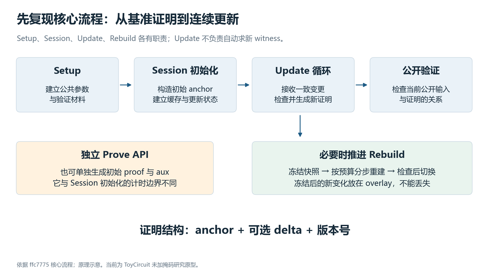
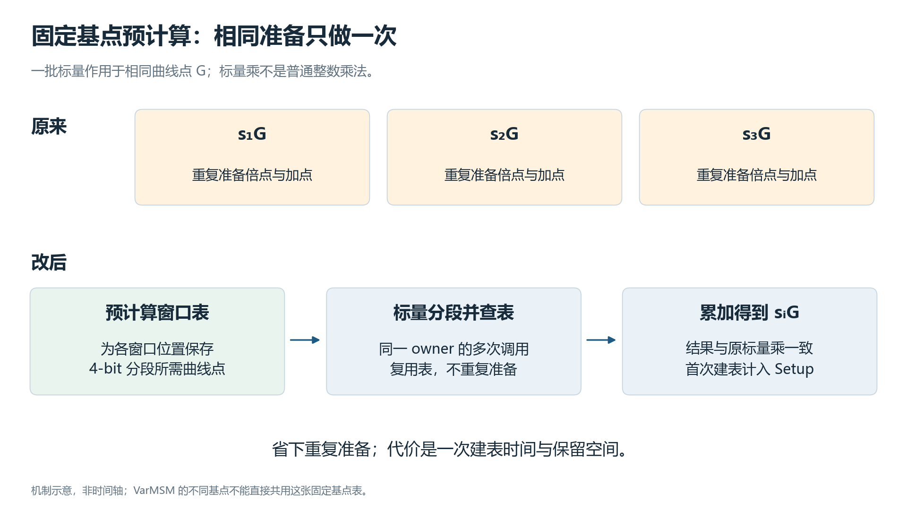
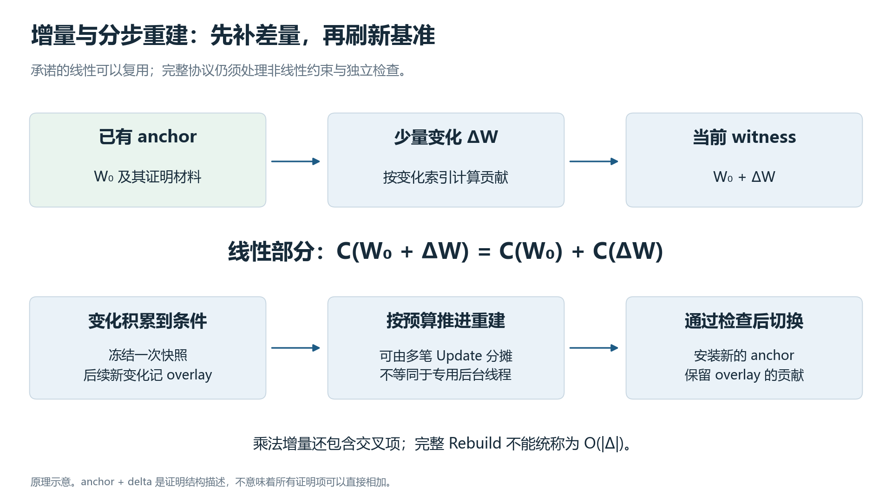
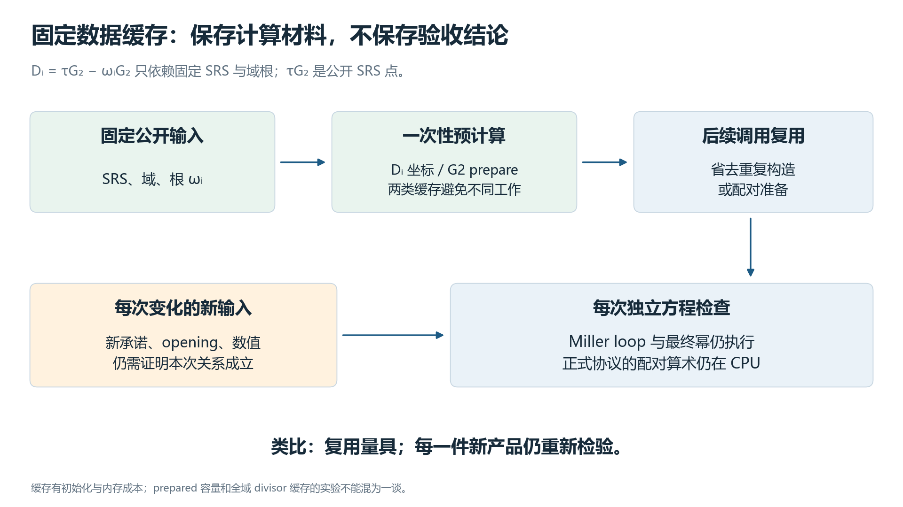
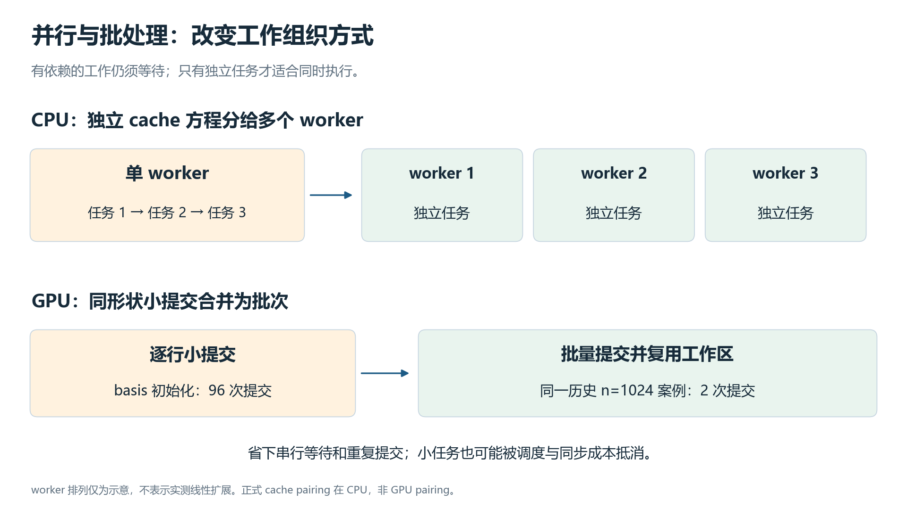
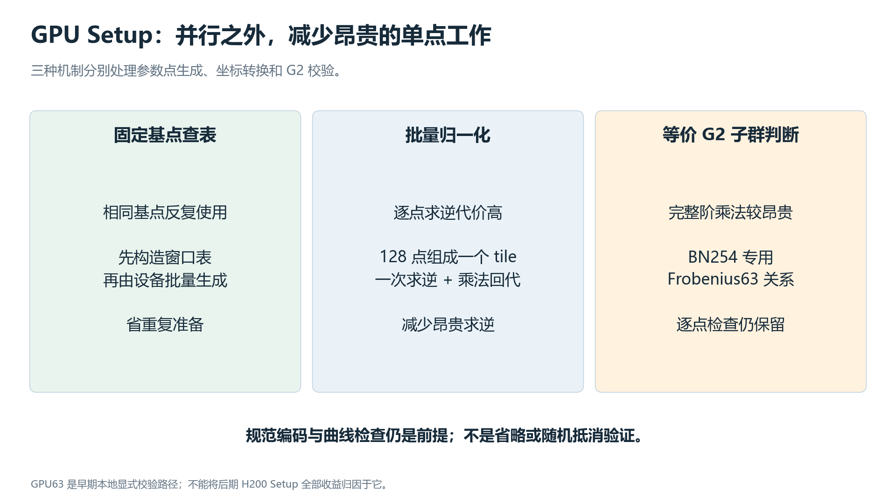

# Dynaverse 科研轮转：组会速通讲义

适用：2026-11-05 组会；默认准备 10—12 分钟汇报。整理于 2026-11-04，依据已封存源码和最终成果报告，没有新增实验。先读第 1、2、5 节，再用配套的《PPT逐页素材与讲稿》排练。

## 1　第一篇章：Dynaverse 核心协议复现

### 1.1　这项复现做成了什么

可以这样汇报：

> 我们首先完成了 Dynaverse 核心协议流程的工程复现，形成了一个能生成初始证明、接收数据更新、生成更新后证明并进行公开验证的研究原型。在此基础上，才对重复计算、缓存和 CPU/GPU 执行路径做优化。

这里的“复现”指核心正确性流程与研究原型。当前实现是未加掩码模式，不能表述为已经完整复现零知识隐私保证、原论文全部理论性能或生产安全能力。实验主要使用 ToyCircuit，不能说已经覆盖任意真实业务电路。

复现的价值有三点：把协议描述落实为可执行代码；保留独立 CPU reference 作为比较依据；建立可重复的更新、重建、验证与计时入口，使后续优化有基线。

### 1.2　先认识六个词

| 术语 | 直观理解 | 本项目中的作用 |
| --- | --- | --- |
| witness | 一次计算里各条线的实际数值 | 更新时发生变化的数据 |
| 约束 | 数据必须满足的等式，例如 a+b=c、c·d=e | 防止把不合法的新数值当作有效更新 |
| 承诺 commitment | 与数据绑定、支持后续证明检查的群元素 | 不是普通哈希，但可以先理解为“可参与代数运算的数据凭据” |
| anchor | 一份已经建立的基准快照及证明材料 | 后续更新围绕它表示差量 |
| delta | 当前 witness 相对 anchor 的变化 | 是数据差量；DeltaProof 则是说明更新仍满足协议关系的证明材料 |
| opening cache | 帮助后续构造/检查证明的预计算材料 | 它依赖 anchor，不能在 anchor 改变后不加区分地沿用 |

### 1.3　完整流程怎么讲

1. Setup：按电路建立参数、SRS 和验证所需材料。
2. 初始证明与验证：为有效的初始 witness 建立 anchor proof，检查协议关系。
3. Session 初始化：为连续更新建立可复用状态，包括 anchor、缓存、差量记录和重建计划。本项目的 session 初始化本身也构造并验证初始 anchor；独立 Prove 测量是另一个 API，不能把两者理解成同一条调用链中只构造一次后直接传入。
4. Update：调用方给出变化位置及新值；系统规范化变化，检查受影响约束，构造新的证明状态。
5. 必要时推进 Rebuild：变化积累后，冻结一个快照，分步构造新的 anchor；通过检查后切换，同时保留冻结之后的新变化。
6. 公开验证：使用验证密钥检查更新后的证明与当前公开输入是否一致。

更新后的 proof 可直观理解为“anchor proof + 相对 anchor 的 delta proof”。这只是组成关系，不是说整个 proof 对象可以直接相加；某些线性承诺确实可以做群加法。

### 1.4　用一个算术例子理解 Update

初始数据：a=2，b=3，c=a+b=5，d=4，e=c·d=20。

如果 b 改成 4，为保持约束，c 应改成 6，e 应改成 24；在 ToyCircuit 中 c 对应的复制线也要同步更新。调用方提交这些一致的 witness 变更，Update 再检查和证明它们。

本实现的 Update 不负责根据一个输入自动求出全部新 witness。因此，这个流程和“用电路 DAG 自动传播所有计算结果”是两件不同的事。

### 1.5　源码怎样证明流程确实接通了

源码引用使用公开快照 a1e6b1ea0304ad1797233fc8d13dda303bc703d4；以下摘录已与该公开快照逐项核对。性能实验仍对应最终报告中各自冻结的历史源码。下面是实际源码摘录，省略上下文，不是可以单独运行的完整程序。

第一段：证明对象本身保存 anchor、可选 delta 和版本号。

~~~rust
pub struct DynaverseProof {
    pub anchor: AnchorProof,
    pub delta: Option<DeltaProof>,
    /// Generation when the current anchor was last rebuilt.
    pub anchor_generation: u64,
    pub generation: u64,
}
~~~

来源：[types.rs，第 166 行](https://github.com/XIAZIHAN001/ZKP-Dynaverse/blob/a1e6b1ea0304ad1797233fc8d13dda303bc703d4/crates/protocol/src/types.rs#L166)。

第二段：已有测试连续调用 Update，并用两条验证路径检查结果。

~~~rust
let proof = session.update(&Update {
    indices: vec![4*n+i, 5*n+i], values: vec![next, output],
}).unwrap();
assert!(vk.verify(session.current_instance(), &proof).unwrap());
assert!(vk.verify_reference(session.current_instance(), &proof).unwrap());
let receipt = session.last_receipt();
assert!(receipt.rebuild_units <= receipt.allowance);
~~~

来源：[incremental_rebuild.rs，第 23 行](https://github.com/XIAZIHAN001/ZKP-Dynaverse/blob/a1e6b1ea0304ad1797233fc8d13dda303bc703d4/crates/protocol/tests/incremental_rebuild.rs#L23)。该测试所在循环还检查重建切换确实发生。这展示了验收方法，不代表今天重新运行过测试。

真实 Update 的主线可压缩为：

~~~text
规范化变更，排除没有改变的值
→ 检查受影响门的公开/复制/加法/乘法约束
→ 开启事务，更新相对 anchor 的差量
→ 生成稀疏证明；必要时冻结快照并按预算推进重建
→ 检查 anchor、delta 及公开输入绑定
→ 全部成功后提交；失败则回滚，无法安全回滚时标记会话故障
~~~

这是教学摘要，不是原始函数逐行复制。对应源码：

- [rebuilding.rs，第 178 行](https://github.com/XIAZIHAN001/ZKP-Dynaverse/blob/a1e6b1ea0304ad1797233fc8d13dda303bc703d4/crates/protocol/src/dynaverse/rebuilding.rs#L178)：规范化变更。
- [rebuilding.rs，第 211 行](https://github.com/XIAZIHAN001/ZKP-Dynaverse/blob/a1e6b1ea0304ad1797233fc8d13dda303bc703d4/crates/protocol/src/dynaverse/rebuilding.rs#L211)：局部约束检查。
- [rebuilding.rs，第 224 行](https://github.com/XIAZIHAN001/ZKP-Dynaverse/blob/a1e6b1ea0304ad1797233fc8d13dda303bc703d4/crates/protocol/src/dynaverse/rebuilding.rs#L224)：事务开始与失败回滚。
- [rebuilding.rs，第 335 行](https://github.com/XIAZIHAN001/ZKP-Dynaverse/blob/a1e6b1ea0304ad1797233fc8d13dda303bc703d4/crates/protocol/src/dynaverse/rebuilding.rs#L335)：稀疏证明与重建分支。
- [rebuilding.rs，第 361 行](https://github.com/XIAZIHAN001/ZKP-Dynaverse/blob/a1e6b1ea0304ad1797233fc8d13dda303bc703d4/crates/protocol/src/dynaverse/rebuilding.rs#L361)：按本次预算推进状态机。
- [rebuilding.rs，第 420 行](https://github.com/XIAZIHAN001/ZKP-Dynaverse/blob/a1e6b1ea0304ad1797233fc8d13dda303bc703d4/crates/protocol/src/dynaverse/rebuilding.rs#L420)：anchor/delta 及公开输入绑定检查。
- [rebuilding.rs，第 250 行](https://github.com/XIAZIHAN001/ZKP-Dynaverse/blob/a1e6b1ea0304ad1797233fc8d13dda303bc703d4/crates/protocol/src/dynaverse/rebuilding.rs#L250)：成功后提交并发布。

口头只需讲清：先确认改得合法，再算增量和必要的重建，最后检查并提交。

## 2　第二篇章：优化原理——少重复、可复用、能并行

### 2.1　固定基点预计算：同一套基础材料先算一次

Setup 需要大量椭圆曲线标量乘。G 是曲线点，sG 是标量乘，不是普通整数乘法。

本项目 FixMSM 主要生成一批 sᵢG，基点 G 相同；VarMSM 则计算 ΣsᵢPᵢ，不同项的基点 Pᵢ 可以不同。

原来：针对同一个 G，反复做相似的倍点、加点准备。

改后：建立 4-bit 窗口表。把标量分成小段，每段查询预先算好的曲线点，再相加。表还可以跨同一 owner 的调用复用。

直观类比：重复做相同菜品，先统一备料。第一次备料要花时间、占空间，后面每次制作更便宜。

它不改变计算结果，也不是让所有 VarMSM 都查同一张固定基点表。CPU 单独固定表阶段，n=1024 的 Setup 曾从 13.04 秒降到 2.49 秒；后来的 25.51× 是固定表和多线程等组合效果。

### 2.2　NTT 计划复用：同一种变换的“工具”不用每次重做

NTT 可先理解为有限域里的快速傅里叶变换，用于多项式的系数表示和取值表示之间转换，也用于快速卷积。

同一长度、同一域的变换会重复使用相同 domain、旋转因子幂表和长度逆元。

改后：按长度保存这些准备材料，下一次直接复用。参考路径已经使用 FFT/NTT；本轮不是把朴素 O(n²) 变换升级为 NTT，而是减少已有快速变换的重复准备。

准确地说，参考 domain 已保存 size_inv；只有重新创建 domain 才重新求逆，不能说每次 NTT 都必定重新求逆。

收益为什么有限：省下的是“准备工具”，蝶形算术、曲线点运算及其他证明阶段仍要执行。单独 NTT 实验没有得到显著、统一的 Prove 提速；CPU 三项组合后，小规模 Prove 约改善 4%。

### 2.3　稀疏增量与分步重建：少量变动先处理差量

设 W₀ 为 anchor 对应 witness，ΔW 为相对它的变化。线性承诺满足：

$$C(W₀+ΔW)=C(W₀)+C(ΔW)$$

因此，可以复用 C(W₀)，只计算变化项的贡献；未变化的线性字段、固定 G2 数据和缓存也尽量复用。

直观类比：账本只新增几笔时先记补充记录，避免每次重抄全账。

补充记录不能无限增长。达到条件后，冻结一次快照，分步构建新的基准；构建期间的新变化记入 overlay，切换后仍要覆盖这些变化。这里的“分步重建”由 Update 按预算推进，不代表另开后台线程。

不能把所有证明都按线性相加。乘法约束涉及：

$$ (f+δ_f)(g+δ_g)-fg=fδ_g+gδ_f+δ_fδ_g $$

最后的交叉项必须保留。完整重建仍可能做全域多项式计算与独立检查，不能笼统称为 O(变化个数)。

早期还实现过平衡子积树、快速插值和 Newton 精确除法等通用方法，以减少多项式重复处理。这属于已做过的算法实现积累；部分旧 UpdateSession 实验入口后来已从当前构建移出，不能与当前 IncrementalSession 混成同一条默认调用路径。

### 2.4　固定公开数据缓存：缓存材料，不缓存“这次合格”

缓存检查中反复使用：

$$D_i=τG₂-ω_iG₂$$

它只依赖固定 SRS 和域根。τG₂ 是 SRS 给出的公开点，这个表达式不要求系统持有秘密 τ。

两种缓存要分清：

| 缓存 | 保存什么 | 避免什么重复工作 |
| --- | --- | --- |
| affine divisor | Dᵢ 的曲线点坐标 | 反复构造相同 Dᵢ 的标量乘 |
| prepared-G2 | 固定 G2 点的配对准备系数 | 反复做配对前的 prepare |

每次变化后的证明仍要通过独立方程；Miller loop 和最终幂仍执行。类比是复用量具，不是把上次的“合格章”盖到新产品上。

收益取决于命中率和容量。H200 n=65536 的一次独立对照中，全域 divisor 缓存使两笔 Update 合计从 379.45 秒降到 292.01 秒，降时 23.04%；扩大部分 prepared 容量的另一对照只改善 1.89%。两者不是同一项优化，也不保证缓存越大越好。

### 2.5　CPU 并行与 GPU 批处理：让独立工作一起做

CPU：FixMSM 批量任务、VarMSM 和独立 cache 方程具备并行机会。建立有上限的局部线程池，把独立工作分给不同 worker。

GPU：大量同形状任务适合并行；过多小提交却会带来主机和设备交互开销。因此把小任务组成批次，并复用设备缓冲区。

已有独立实验中，8-worker MSM 原语相对同 feature 的 1-worker 约快 5.85—6.35 倍；H200 的 CPU cache 检查使用 1→8 workers 后，n=65536 完整重建 Update 从 146.25 秒降到 35.39 秒，约 4.13×。这是正式路径上的 CPU 配对并行，不能说成 GPU pairing。

basis 初始化曾把 96 次小提交合并为 2 次。小部件大幅变快，不代表整个程序也有相同倍数。

### 2.6　GPU Setup：并行之外，还要减少昂贵求逆和校验

这部分有三个相互区别的机制：

1. 固定基点查表：与前述预计算原理一致，设备上批量生成参数点。
2. 批量归一化：把一批曲线点转成所需坐标时，利用乘积与回代，将逐点求逆改成每个 tile 一次求逆加若干乘法；这里每个 tile 为 128 点。求逆昂贵，减少次数可以省时间。
3. 等价 G2 子群判断：利用 BN254 的特殊结构，用经过数学核验的 Frobenius63 关系替代完整阶乘法谓词；规范编码、曲线检查和逐点子群判断仍要保留。这个专用校验路径有早期本地显式 GPU63 实验，不能单独认领后期 H200 的全部收益。

组会可讲：“我们既增加算术并行度，也减少单点上过于昂贵的准备、求逆和校验开销。”不必在主讲中推导 Frobenius 关系。

## 3　第三篇章：工程整理做了什么

资源方面：共享不可变 SRS，复用工作区，减少全量复制，缩短临时数组同时存活的时间。其原理是避免为同一份不变数据保存多份副本。

历史独立 CPU anchor 诊断的请求分配峰值从约 1.173 GB 降到 1.003 GB，降幅 14.48%。这是 Rust 请求分配统计，不等于整个进程 RSS 或显存峰值。

代码方面：保护原版与 Git 历史后，收敛正式入口，把旧 UpdateSession、旧 benchmark 和未接入正式协议的 GPU pairing 研究代码移出当前构建，留下恢复清单。相同统计口径下，物理代码行从 42,393 降到 34,271，减少 19.16%。

这项成果说明可维护性改善，不是性能加速。精简候选没有新的完整 GPU/native 运行资格，历史性能不应改标为精简版新实测。大规模完整工程化也还没有全部闭合。

## 4　结果怎样讲才准确

下面各行来自不同冻结实验，不能把倍率相乘，也不能组合成统一全流程加速。

| 对照 | 规模与用时 | 能说明什么 |
| --- | --- | --- |
| CPU 参考 → CPU 三项组合 | 本地 n=1024，Setup 12.872→0.505 s，25.51× | 固定表、NTT 计划及有界并行组合，收益集中于 Setup；三对独立进程中位数 |
| H200 同源码优化 CPU → GPU | n=65536，Setup 60.226→15.113 s，3.985× | 主汇报结果；各一次 API 观察 |
| GPU 默认 → GPU 组合策略 | H200 n=65536，两笔 Update 合计 1254.203→379.355 s，3.306× | GPU 路线内部优化，不能叫 CPU/GPU 倍率 |
| cache workers 1 → 8 | H200 n=65536，重建 Update 146.247→35.387 s，4.133× | 同历史二进制的 CPU 配对检查并行收益，每路两笔均值 |
| 同源码优化 CPU → GPU | H200 n=65536，Prove+aux 663.003→665.867 s | 该路径没有明显 GPU 收益 |
| 同源码优化 CPU → GPU | H200 n=65536，普通 Update 0.150→0.223 s | 小任务 GPU 反而慢，不能说所有阶段都加速 |

主汇报只需牢牢记住：在本次 n=2¹⁶、131072 个算术门的 ToyCircuit 实测中，H200 将 Setup 从约 60 秒缩短到 15 秒；保守表述为“Setup 阶段 GPU 加速超过 3 倍”。

计时软件与口径：自研 Rust full_divisor_probe 使用 std::time::Instant 记录 API 墙钟；Python monotonic_ns 记录完整诊断进程；CUDA event 记录对应设备子阶段。主汇报 3.985× 使用 API 墙钟。Setup 是一次观察，普通 Update 为四笔中位数，完整重建 Update 为两次预热后两笔均值。内部必需检查计入 API，调用后的额外 Reference/oracle 单独计时。

## 5　一天怎么准备

建议总投入约 6 小时，包含休息。目的是能解释流程、原理和证据，不是一天重学全部密码学。

| 时段 | 做什么 | 通过标准 |
| --- | --- | --- |
| 第 1 小时 | 读第 1 节，手画完整流程，练习算术更新例子 | 能解释 Setup、Session、Update、Rebuild 的区别 |
| 第 2 小时 | 学固定表、NTT 计划、增量线性公式 | 每项能说“原来做什么、现在省了什么” |
| 第 3 小时 | 学固定数据缓存、CPU 并行、GPU 三个机制 | 能解释为何没有跳过验证 |
| 第 4 小时 | 阅读配套 PPT 素材，选 3 张结果图和所需原理图 | 每页只保留一个结论，脚注不丢 |
| 第 5 小时 | 对着 PPT 讲两遍，每遍 10—12 分钟 | 不照读全文，能讲出原理和一个例子 |
| 第 6 小时 | 练下面的问答，再压缩为 3 分钟版本 | 能准确说明负结果、未完成项和未来方向 |

来不及就只看：第 1 节、2.1、2.3、2.4、第 4 节以及下方问答。NTT 蝶形、配对公式和 Frobenius 详细证明放在备份材料。

## 6　组会最可能被问到的问题

**问：你们做的是新密码协议，还是优化实现？**

答：先复现核心协议正确性流程，再优化既有协议的算术实现、重复计算、数据复用和执行组织。固定窗口、NTT、批量归一化和线程池都是已有技术；我们的工作是识别瓶颈、适配调用路径、维护正确性与资源边界并实测，不能把这些通用方法说成原创算法。

**问：为什么数据只变一点，不能始终只做一点工作？**

答：部分线性承诺可以按差量更新，但乘法约束有交叉项；差量会积累，anchor 和 opening cache 也要更新。完整重建与独立检查仍可能遍历全域。

**问：你说“后台重建”，是不是专门开了线程？**

答：本次主线是由每笔 Update 按预算推进的状态机。“后台”描述工作被分摊，不应解释为单独的 BackgroundRebuilder 线程；旧线程重建入口已经退役归档。

**问：缓存会不会把旧的验证结果复用到错误的新证明上？**

答：保存的是固定 SRS 和域根决定的点与 prepare 材料，不是 witness 或“通过”结论。变化后的方程仍独立检查。

**问：GPU 究竟快多少？**

答：本次 H200 n=65536 对照中，Setup 实测约 3.99×，保守说超过 3×；完整重建 Update 的特定样本约 11.66×。Prove 没有明显变快，普通小 Update 反而更慢，因此没有统一全流程倍率。

**问：CPU 为什么能有 25 倍，GPU 主结论只有 4 倍？**

答：前者是小规模 CPU 参考与 CPU 组合优化之间的比较；后者是 H200 大规模优化 CPU 与 GPU 的比较。版本、规模、对照基线和统计口径不同，不能横向比较两个倍率。

**问：GPU 模式为什么 Prove 仍要 600 多秒？**

答：该证明路径仍有 host KZG G1 卷积/FFT 等昂贵工作，没有整段迁到 GPU。加速少数算子，并不会自动消除其余瓶颈。

**问：普通 Update 变慢是不是线程或 GPU 调用开销造成的？**

答：小任务中派发、同步与传输开销可能抵消并行收益，但现有实验没有单独消融来锁定唯一原因。应该报告已观察的回退，再说明这是待验证解释。

**问：怎么确认没有算错？**

答：保留 CPU reference，进行算子与证明对照；更新后检查公开验证、witness/证明一致性、预算与异常拒绝。测试支持其覆盖范围内的正确性，不等于新的形式化安全证明；忽略与未完成测试不计为通过。

**问：后续 DAG 要优化哪里？**

答：讨论的是 proof 生成中承诺、多项式变换和 opening 等任务的依赖图，不是自动求 witness 的电路 DAG。尚未真正实现和实验，可能因共享工作区、显存与带宽竞争而收益不佳；当前重建热点又主要在 CPU 配对检查。

## 7　两段可直接口述的话

### 开场约 45 秒

> 这次科研轮转主要做了两层工作。第一层是完成 Dynaverse 核心协议流程的工程复现，跑通初始证明、连续更新、分步重建和公开验证，形成可比较的正确性基线。第二层是在这个原型上减少重复计算，包括固定基点预计算、NTT 计划复用、稀疏增量计算、固定公开数据缓存，以及 CPU 并行和 GPU 批处理。当前成果是未加掩码的研究原型。性能上，最适合主汇报的结果是 H200 在 n=65536 的 Setup 阶段，把约 60 秒缩短到 15 秒，保守表述为超过 3 倍加速。

### 优化原理约 60 秒

> 这些优化可以归为三类。第一类是避免重复准备，例如同一个基点的窗口表、同一个域长的 NTT 计划，以及固定 G2 点的校验准备材料。第二类是利用增量结构：数据只变化一部分时，先计算这部分对线性承诺的贡献，再通过分步重建更新基准。第三类是组织执行：把独立任务分给多个 CPU worker，把 GPU 上的同形状小任务合成批次。它们的共同点是减少重复工作或缩短独立任务的等待，但变化后的证明仍然要检查。收益也不是均匀的：Setup 和部分重建明显受益，完整 Prove 与小 Update 还存在瓶颈。

## 8　资料位置

- [PPT 逐页素材与讲稿](PPT逐页素材与讲稿.md)：12 页完整素材，其中 2 页可选。
- [最终成果报告与原始数值口径](https://github.com/XIAZIHAN001/ZKP-Dynaverse/blob/a1e6b1ea0304ad1797233fc8d13dda303bc703d4/docs/research-results-20261104/README.md)。
- 本目录 figures：6 张原理图的 PNG/SVG，3 张既有结果图。PNG 可直接插入 PPT，SVG 便于放大编辑。图中示意不能当作执行计时轨迹。

本讲义与配图作为仓库文档分发。源码链接指向固定公开快照，在 Mac 与浏览器中均可查看；性能数据仍对应各自历史实验。本次没有新增实验。
