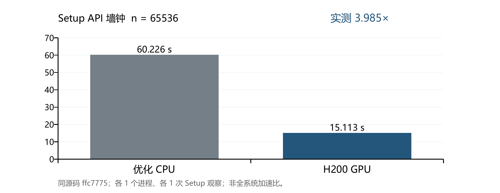
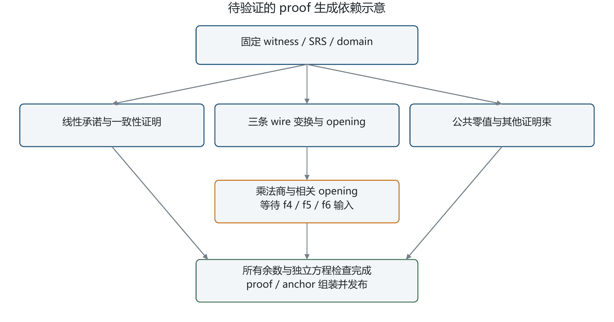

# Dynaverse 科研轮转成果最终报告

整理日期：2026-11-04；历史测量截止：2026-10-29。

[下载 Word 最终报告](Dynaverse_科研轮转成果最终报告.docx) · [实测数据](data/measurements.json) · [来源记录](#sources)

文中结果对应各自冻结的历史源码和测试条件。本次仓库更新发布成果文档，不将仓库当前代码追认为所有历史实测版本。

## 1　GPU Setup 实测与保守汇报口径

主汇报表述：在 n=2¹⁶、131072 个算术门的 ToyCircuit 实测中，H200 GPU 相对优化后的 CPU 将 Setup 用时从 60.23 秒缩短至 15.11 秒，实测加速约 3.99 倍、耗时降低约 74.91%。保守表述为“Setup 阶段 GPU 加速超过 3 倍”。这一数字限定于该实验条件与阶段，不代表完整证明系统或所有电路的统一加速比。

本组取自 2026 年 10 月 29 日 H200 作业 1291 的两个已完成模式，源码均为 ffc7775，CPU 与 GPU 各一个完整诊断进程且原始日志复核通过。Setup 是各进程的一次 API 观察，未对多个独立冷启动重复取均值，也没有清空驱动或文件系统缓存。汇报宜使用“在本次实测中”，不作置信区间或保底性能承诺。[E7]

图 1　主汇报图 GPU Setup 加速。记录软件为自研 Rust full_divisor_probe，计时器为 std::time::Instant；两柱各代表一次 prove_setup 事件。

表 1　该主结论的比较条件

| 项目 | CPU 路线 | GPU 路线 |
| --- | --- | --- |
| 源码 | ffc7775dcf8a93fb4d9aa842316cd0ad67eeae94 | 相同源码与探针 |
| 硬件 | AMD EPYC 9V74 主机；8 Slurm 逻辑 CPU 配额 | 同主机；1 张 NVIDIA H200 NVL，SM90 |
| 算法状态 | 启用三项 CPU 候选，缓存 worker=8 | 正式 GPU 算子与既有协议缓存优化，缓存 worker=8 |
| 统计量 | 一次 prove_setup API 墙钟 60.225902530 s | 一次 prove_setup API 墙钟 15.112562773 s |
| 比值定义 | S = T_CPU / T_GPU | S = 3.985154830；时间降幅 74.906872% |

表 2　H200 n=65536，同源码完整诊断通过的两种模式，单位 s

| 阶段 | CPU 候选 | GPU 模式 | CPU / GPU |
| --- | --- | --- | --- |
| Setup | 60.225903 | 15.112563 | 3.985× |
| Prove + aux | 663.002598 | 665.867489 | 0.996× |
| Session 初始化 | 732.432958 | 81.501068 | 8.987× |
| 普通 Update | 0.150181 | 0.222679 | 0.674× |
| 完整重建 Update | 413.039682 | 35.430819 | 11.658× |

GPU Setup 为 CPU 候选的 3.985×加速，Session 初始化约 8.987×，完整重建 Update 为 11.658×。Prove 为 663.003 / 665.867 秒，几乎没有 GPU 收益；该路径仍包含 host KZG G1 卷积/FFT，不能把“GPU 模式”理解为整段 Prove 已迁到 GPU。普通 Update 为 0.150181 / 0.222679 秒，GPU 慢 48.27%。这些普通样本都是两 wire 变更，四笔中的 rebuild 子钟均为 0；其他普通 Update 仍可能推进重建。

表 3　同两笔完整重建 Update 的互斥子阶段均值，单位 s

| 模式 | 总 Update | G1 变换 | cache 检查 | 多项式 |
| --- | --- | --- | --- | --- |
| CPU 候选 | 413.039682 | 357.821951 | 26.323522 | 27.423197 |
| GPU | 35.430819 | 5.537075 | 26.554128 | 1.329849 |

![图 2　完整重建热点迁移：CPU 的 G1 变换占 86.63%；GPU 的 cache 检查占 74.95%。其余阶段由父墙钟扣除所列互斥子阶段得到，非额外收费。[E7]](figures/fig06_rebuild_composition.png)

图 2　完整重建热点迁移：CPU 的 G1 变换占 86.63%；GPU 的 cache 检查占 74.95%。其余阶段由父墙钟扣除所列互斥子阶段得到，非额外收费。[E7]

CPU 重建的瓶颈仍是 G1 变换；NTT 计划复用没有消除点运算，MSM 的 8-worker 局部池也没有并行化 NTT 蝶形。GPU 已显著缩短 G1 与多项式阶段后，约 26.55 秒的 CPU cache 检查成为主要限制。该观察解释了为何局部算子加速不能按比例传递到所有阶段。

GPU / CPU 候选的独立完整诊断进程分别为 4023.300449 / 9122.277428 秒；其内部多案例与 oracle 不等于服务工作负载。本轮 Reference 完整诊断被中断，历史 83 案例批量对照未执行，作业 1291/1292 已按停止要求取消。尚未闭合的 Reference API 事件不作为正式优化前数据，不能据此宣称已逐模块选出全部历史最优。

在 PPT 正文中优先使用 Setup 的“超过 3 倍”结论。完整重建 Update 的 11.658×保留为特定 16-wire 付费重建样本，注明两笔均值；它不能改写成“所有 Update 加速 11.66 倍”。普通 Update 的 0.674×和 Prove 的 0.996×也应在阶段对照中保留。

## 2　实验环境 时间记录软件与统计方法

结果对应 2026 年 10 月各自冻结版本，整理与离线复核日期为 2026 年 11 月 4 日。本次补充文档没有重跑实验或启动远端任务。规模记为 ToyCircuit 参数 n，算术门数为 2n；报告的秒数由原始纳秒字段除以 10⁹，毫秒由纳秒除以 10⁶。以纳秒存储不等于具有纳秒级测量精度。

### 2.1　运行软件与硬件配置

表 4　主要证据组的软件身份与运行约束

| 证据组 | 运行与编译软件 | 硬件及限制 |
| --- | --- | --- |
| E1 本地 CPU 最终配对 | Rust 1.89.0，release、locked/offline；cpu-parallel 候选；RAYON_NUM_THREADS=1；ark-poly parallel 关闭 | Intel Core Ultra 9 275HX；8 逻辑 CPU 配额，512 MiB，swap=0，pids=64；参考 MSM 1 worker，候选 8，cache 均 8 |
| E7 H200 主汇报组 | Rust 1.89.0；SM90 native；ICICLE 锁定提交 aacec3f72f14f53dd96d835698d2c87cde3a68b8；RAYON_NUM_THREADS=1、OMP_NUM_THREADS=1 | AMD EPYC 9V74；H200 NVL，nvidia-smi 报告 143771 MiB；驱动 595.84；8 逻辑 slots 实际覆盖 4 物理核、2 NUMA |
| E10 早期本地 GPU Setup | Rust 1.89.0，CUDA 12.8.1，固定 ICICLE 提交；Rust 显式 G2-6 测试探针；TableBatchNormalize + GPU63 | RTX 5070 Ti Laptop，SM120；自然 CPU 对照已使用当时 FixedBaseCpuBackend；正式值为同进程暖态 |
| E5 H200 缓存并行 | 历史构建 37c8f4a，同一二进制；专用 cache pool 1/2/4/8 workers | 固定 8 CPU slots + 1 H200；n=65536 每 owner 2 GiB 配额，n=262144 为 8 GiB |

E7 的 CPU 亲和性为 [0,1,80,81,160,161,240,241]，不能写成 8 个独立物理核。H200 驱动号来自该轮保存的 nvidia-smi 输出；CUDA Toolkit 的具体版本不从本机 CUDA 12.8.1 推定。E7 的已引用模式回执没有给出 Toolkit 完整版本号，原始环境命令包括 nvcc --version，进一步复现实验时应随环境日志携带。

E7 native 库 SHA256 为 41172ebd…73abe8，架构为 90；两个模式的 Rust 二进制分别有独立 SHA256，模式结果同时绑定源码、native、探针和原始 stdout 哈希。E10 是较早源码包 G2-6-local 的数据，不能因函数名相同而与后期优化 CPU 拼接比较。

### 2.2　时间记录由哪些软件完成

表 5　记录工具 时钟及输出含义

| 记录层 | 软件与时钟 | 原始输出 | 解释 |
| --- | --- | --- | --- |
| API 与协议子阶段 | 自研 Rust full_divisor_probe；std::time::Instant::now 与 elapsed().as_nanos() | stdout 的 CPU_OPT / GPU_OPT API 事件；divisor_initial、divisor_update 与 timings；离线生成 ANALYSIS.json | 调用者墙钟，可能包含 CPU、提交、读回、同步和内部检查；不是 CPU 指令时间或纯 GPU kernel 时间 |
| 完整诊断进程 | Python 3 subprocess 包装器；time.monotonic_ns() | PROCESS.json 中 process_wall_ns、exitcode、timed_out | 记录独立可执行进程生命周期；H200 wrapper 还计入监测线程收尾与输出关闭，不是单次 API |
| 设备子阶段 | CUDA runtime events；cudaEventRecord 与 cudaEventElapsedTime | device_generate_ns、device_normalize_ns、subgroup_kernel_event_ns 等 | 设备 stream 上两个 event 之间的范围；仅用于对应子阶段，不能替代 Rust API 墙钟 |
| 调度作业时间 | Slurm scontrol；已结束子进程采用 PROCESS 回执 | RunTime、状态及分阶段回执 | 包括编译、测试和多个串行阶段；排队等待不算计算 RunTime；不作为算法延迟 |
| 资源观察 | Python 监测 /proc 状态并调用 nvidia-smi；约 5 秒一次 | samples.jsonl；VmRSS、VmHWM、Threads、进程显存观察值 | 资源采样；不用于计算算法加速比，也不是完整物理峰值认证 |
| 统计与审计 | 项目 Python JSON/CSV 解析脚本，median / mean 与原值算术复算 | MODE_RESULT.json、FINAL_RESULTS.json、CSV 汇总及哈希回执 | 由选定合法样本计算统计量；不从截图读数，不把构建/回归测试时长当 Setup 或 Prove |

上述主性能数字并非来自 Nsight Systems/Compute 的整段 profile。早期 Nsight 计数器权限不足的记录不能作为 achieved occupancy 或带宽实测依据。CUDA event 以浮点毫秒返回再换算纳秒；其命名含 kernel 也不能自动解释为无其他 stream 开销的单 kernel 时间。系统日期时间用于记录实验发生时间，耗时计算使用单调时钟。

### 2.3　Setup Prove 初始化与 Update 的计时起止

表 6　E7 API 钟的边界 适用于主汇报组

| 字段或阶段 | 计时起止 | 包含 | 计时外 |
| --- | --- | --- | --- |
| Setup / prove_setup | cpu_optimization.rs 111–114：Instant 开始后 make 后端，再创建 RNG 并执行 setup / setup_with_backend；随后停止 | 后端创建、该调用内的固定表准备及 Setup 算术；实际发生的 GPU 交互 | ToyCircuit 及 valid_instance 已在此前建立；独立 CPU oracle、后续 Prove 与外部验证 |
| Prove + aux | 115–126：围住 prove 闭包，得到 proof 与 aux 后立即取 elapsed | AnchorOpeningPolicy::Precompute 路径的证明和 aux 预计算 | verify_reference、独立重新 Setup 的 oracle 与 proof/aux 比较；这些仍在完整进程里 |
| ordinary Session 初始化 | 153–158：围住 start_incremental_session，返回 session 即停 | 已有参数上的增量状态、resident、初始 anchor/cache 与内部验证 | 前一阶段 Setup；调用后的 exact state 比较与 verify_reference；后端在 Setup 时已创建 |
| 普通 Update | 160 起：围住 session.update，proof 返回即停 | 应用两 wire 变更及内部实际执行的增量/重建工作 | 调用后 receipt/完整 witness 比较、verify_reference 与额外 dense oracle |
| 完整重建 Update | flow.rs 55–56：围住 s.update；正式样本 step≥2 | 16-wire large_batch 更新、完整重建及其内部独立 cache 方程检查 | 调用后的外部 Reference 和额外验收；前两笔预热也不进入正式均值 |

表中行号对应冻结的 ffc7775 测量源码。Setup 取 prove_setup，不取另一个独立 ordinary_setup 后混成平均；一次诊断中会为不同案例和 oracle 再执行 Setup。E7 Session 表使用 ordinary_initialization；full-divisor Off/On 路线的 divisor_initial 是另一计时边界，flow::start 的时钟从 backend 创建前开始，因此两类初始化不得随意互换。

E10 早期 GPU Setup 的 setup_sample 在 ToyCircuit 与 RNG 建好后围住 setup_with_backend；owner 在外层建立。首次调用使用新表/owner，但 context 创建仍在 Setup 钟外；后续正式样本复用表/owner。其 10 笔暖态中位数不能称为 10 次独立冷启动，也不能与 E7 单次 Setup 用完全相同的冷启动定义。

### 2.4　父子时间与外部验收的关系

Setup 建立公共参数/SRS。Session 初始化使用这些参数与初始 witness 建立可更新状态。Rebuild 为冻结 witness 重建 anchor/opening cache，可由一笔或多笔 Update 支付；它不是再次 Setup。Update 可以只做小变更，也可以推进或完成 Rebuild。

典型重建计时层级为 Update → preparation/Rebuild → cache_check → divisor/prepare/Miller/最终幂。父墙钟已经包含子阶段。正文中 Update、Rebuild 与 cache_check 只用于定位同一时间的组成，不能相加成新的总耗时。并行 worker 的 elapsed 累计是各任务时间之和，与外层真实经过时间有不同分母；不能将它加到 Update。

内部 cache 检查属于 Update 调用，保留每笔 2n 条独立方程；外层 verify_reference 在 API 计时停止后另测。独立 oracle 另行运行以检验结果，属于完整诊断进程。必须区分“API 内部检查”和“API 外部验收”，不能简单说所有验证都排除或都包含。Setup、Prove、初始化和 Update 也不是在一个单路服务样本中测得后可直接相加的独立全流程钟。

### 2.5　样本数 统计量与倍率计算

表 7　各实验组的采样与汇总规则

| 实验组 | 采样设计 | 报告统计量 | 适用边界 |
| --- | --- | --- | --- |
| E7 H200 同源码 CPU/GPU | 每模式 1 个完整诊断进程；普通更新 4 笔；重建路线先 2 预热再 2 正式 | Setup/Prove/初始化各一次；普通取 4 笔中位数；完整重建取 2 笔均值；各阶段 CPU 统计量 / GPU 统计量 | 主汇报 3.985×对应 Setup；未提供重复进程方差或置信区间 |
| E1 CPU 最终 V | 每 n 三对独立进程；顺序 ref→cand、cand→ref、ref→cand | 各进程 Setup/Prove 后取三进程中位数；普通先每进程四笔中位数再三进程中位数；重建先每进程两笔均值再三进程中位数 | 倍率是两组汇总统计量之比，不是逐对倍率的均值或中位数 |
| E1 固定表 / NTT 阶段 | 每配置一个历史单次对照 | 单次 API 墙钟与样本比值 | 不与最终 V 结果混作多次重复 |
| E1 MSM 原语 | 2048 点、固定 seed；每格预热后仅一次；1/2/4/8 workers | 同 cpu-parallel feature 的 1-worker / 各 worker 用时 | 固定表暖态；不是完整 Setup 或 Update |
| E2 GPU 组合策略 | 各硬件/规模独立；每路线 2 预热 + 2 正式 | 两笔正式 Update 合计之比；同组使用相同 window | 对照双方均为 GPU 路线，不能称 CPU/GPU 加速比 |
| E3 / E4 缓存消融 | 各轮按记录切换 prepared 容量或 divisor 开关 | 正文早期表用两笔合计；1174 表用两笔均值，表题标清 | 各轮源码与并行度不同，倍数不串联 |
| E5 cache workers | 同历史二进制，workers 1/2/4/8 固定顺序，每档一进程 | On 两笔正式 Update 均值；完整进程使用独立 PROCESS 钟 | n 两种规模的 owner 配额不同；不宣称线性扩展 |
| E6 basis / divisor 部件 | basis 前后各一进程；divisor 同进程固定次序每档一次 | 部件墙钟和完整诊断墙钟分别报告 | 不将部件 67–71×或 9.9×写成整体加速 |
| E10 早期 GPU Setup | 3 规模 × 7 路径；首调用另列；2 预热 + 10 正式，轮换顺序 | 10 个暖态样本中位数；natural_cpu / GPU63 | 共 231 条 Setup 记录；不是 231 次独立冷启动 |
| E0 早期 CPU/hybrid 序列 | n1024 每模式 8、n8192 每模式 4 稳态序列；每序列 16 updates | 完整序列中位数；CPU / calibrated batch hybrid | 排除共享 Setup 和前台后端初始化，不是单次 Prove |

统一公式：S = T_before / T_after；R = (1 − T_after / T_before) × 100%。CPU/GPU 比较时明确 before=CPU、after=GPU；GPU 内部优化则明确 before=默认 GPU、after=优化 GPU。S<1 或 R<0 表示回退。表中数值保留 3–6 位用于复算，口头汇报采用 2 位小数；“超过 3 倍”是对该样本结果的保守措辞，不是将实际比值重新估计为 3。

例如 E7 Setup：60.225902530 / 15.112562773 = 3.985154830；降时 74.906872%。完整重建：413.0396822045 / 35.4308190725 = 11.657638548。前者对应单次 API 观察，后者对应各路线两笔均值；两者不能互换，也不能与历史 R5 的 3.306×连乘。

### 2.6　有效性与复核依据

原始日志保存纳秒字段与运行身份，PROCESS 回执记录二进制和 stdout/stderr SHA256、退出码及是否超时；汇总结果只纳入相应验收通过的路径。已封存的本地 GPU 最终观察触发资源门禁、performance_eligible=false，不用于 CPU/GPU 倍率。超时的 native 编译不是性能样本，忽略的测试不算实际运行通过。

E7 两个模式已完整结束并通过 raw 复算；Reference 完整诊断中断、83 历史案例批量重测未执行。E1 最终 12 个样本统计与历史清单逐项匹配；E10 的 CSV 哈希与 21 组中位数已核对。小样本、未锁频与固定执行顺序等限制按实验保留，不据此声称统计显著、稳定尾延迟或整个项目累计加速。

## 3　CPU 算术路径优化

### 3.1　固定基点预计算与批量归一化

Setup 中大量标量作用于相同生成元。参考路径已有每 4096 点的批量归一化，但没有跨调用复用的固定基点窗口表。候选为每个 owner 懒创建一张 4-bit G1 表和一张 G2 表，将重复标量乘中的倍点与加点准备转化为查表与累加，仍按 4096 点分块归一化。空输入不建表，首次建表计入 Setup，两张表共保留 216064 字节。[E1]

固定基点阶段的单次对照中，n=256 的 Setup 从 3.265143 秒降至 0.634032 秒（5.150×）；n=1024 从 13.038237 秒降至 2.490807 秒（5.235×）。该阶段只说明固定表本身已产生收益；最终 21–26 倍的 Setup 改善还包含多线程批处理，不能全部归因于窗口表。

### 3.2　NTT 计划复用与规模适配

候选按 BN254 标量域长度缓存 domain、正逆旋转因子幂表和域规模逆 size_inv，同一 owner 的 Fr 与 G1 变换可共享计划。参考 FFT helper 会构造临时旋转因子向量；size_inv 原本保存在 domain 内，仅在重新创建 domain 时才重新求逆。因此，“每次 NTT 都重建旋转因子和重新求逆”并非准确描述。计划复用减少重复准备，没有改变蝶形算术量，也没有把 CPU 蝶形改为并行。[E1]

单独 NTT 阶段的 Prove 单样本：n=256 为 0.948585→0.954502 秒，慢 0.62%；n=1024 为 4.565962→4.485764 秒，降时 1.76%。计划命中不是整段 Prove 显著提速的证据。Setup 的 divisor-Newton、独立 oracle/verifier 等仍有参考 FFT 路径，不能认定全工程所有 FFT 均已缓存。

早期本地配置的域长上限为 16384、计划保留上限 2 MiB。为 n=65536 做的软件适配将绝对域长上限放至 2²⁰，并在该 H200 配置中为每 owner 预留 64 MiB。实际 Prove 发生 22 次 Fr NTT、7 次 G1 NTT，创建 4 个计划、命中 25 次，域长为 65536/131072/524288/1048576，保留 56628816 字节。该适配扩大支持范围，未改变数学算法。[E7]

### 3.3　FixMSM 与 VarMSM 的有界局部并行

CPU 候选通过显式 cpu-parallel 开关建立每 owner 的有界 Rayon 局部池，FixMSM 批次与 G1/G2 VarMSM 均在该池内同步执行；可选 1/2/4/8 workers，每线程栈 2 MiB。parallel-cache 是缓存方程检查的另一开关，不等同于 MSM 并行。候选启用 ark-ec/ff/std 的 parallel 功能，ark-poly parallel 仍关闭。[E1]

表 8　2048 点暖态 CPU 原语，用时单位 ms；同一并行 feature 内比较

| 原语 | 1 worker | 2 workers | 4 workers | 8 workers | 1 / 8 |
| --- | --- | --- | --- | --- | --- |
| G1 VarMSM | 15.102 | 8.049 | 4.578 | 2.539 | 5.947× |
| G2 VarMSM | 46.122 | 24.563 | 13.120 | 7.266 | 6.347× |
| FixG1 | 27.186 | 15.204 | 7.490 | 4.650 | 5.847× |
| FixG2 | 77.433 | 40.042 | 20.351 | 12.270 | 6.311× |

![图 3　暖态 MSM 的线程扩展性。各格仅一次计时；固定表已预热，8-worker 池创建另耗 0.401 ms。原语倍率不等于完整流程倍率。[E1]](figures/fig02_msm_workers.png)

图 3　暖态 MSM 的线程扩展性。各格仅一次计时；固定表已预热，8-worker 池创建另耗 0.401 ms。原语倍率不等于完整流程倍率。[E1]

相同 feature 的 1→8 workers，四类原语达到 5.85–6.35×样本加速。feature 关闭的一线程值略有不同，图表统一使用 feature 开启的一线程作分母，避免将编译路径变化混入线程扩展曲线。短小任务仍可能被派发、同步和归约成本抵消。

### 3.4　CPU 完整阶段的配对结果

最终本地实验每个规模采用三对独立进程，顺序为参考→候选、候选→参考、参考→候选。参考 MSM 为 1 worker，候选为 8 workers，缓存检查均为 8 workers，RAYON_NUM_THREADS=1。Setup、Prove、初始化取三进程中位数；普通 Update 先取每进程四笔中位数，再取三进程中位数；完整重建 Update 先取两笔正式样本均值，再取三进程中位数。测量构建记录 HEAD 为 5d28296，冻结检查点为 42f275f，两者角色不同。[E1]

表 9　CPU 参考与组合候选，单位 s；末列为加速比 / 时间降幅

| n | 阶段 | 参考 | 候选 | S / R |
| --- | --- | --- | --- | --- |
| 256 | Setup | 3.194746 | 0.151039 | 21.152× / +95.27% |
| 256 | Prove + aux | 0.948458 | 0.912991 | 1.039× / +3.74% |
| 256 | Session 初始化 | 1.167070 | 1.167541 | 1.000× / -0.04% |
| 256 | 普通 Update | 0.098236 | 0.103149 | 0.952× / -5.00% |
| 256 | 完整重建 Update | 0.701216 | 0.716798 | 0.978× / -2.22% |
| 1024 | Setup | 12.872259 | 0.504526 | 25.514× / +96.08% |
| 1024 | Prove + aux | 4.538054 | 4.354499 | 1.042× / +4.04% |
| 1024 | Session 初始化 | 5.152674 | 5.159144 | 0.999× / -0.13% |
| 1024 | 普通 Update | 0.098002 | 0.103743 | 0.945× / -5.86% |
| 1024 | 完整重建 Update | 2.992887 | 2.991564 | 1.000× / +0.04% |

![图 4　CPU Setup 实测。两种规模分别达到 21.152×、25.514×；首次固定表构造已计入候选时间。[E1]](figures/fig01_cpu_setup.png)

图 4　CPU Setup 实测。两种规模分别达到 21.152×、25.514×；首次固定表构造已计入候选时间。[E1]

收益集中于 Setup：降时 95.27% / 96.08%。Prove 只改善 3.74% / 4.04%，初始化基本不变，普通 Update 分别慢 5.00% / 5.86%；完整重建 Update 在 n=256 慢 2.22%，在 n=1024 仅改善 0.04%。短 Update 的回退与任务规模和并行管理成本相容，但没有独立消融，不能把原因唯一归结于线程开销。

同组完整诊断进程中位数为 27.678102→18.894674 秒（n=256，1.465×）及 108.392792→71.661550 秒（n=1024，1.513×）。这是验收程序总体用时，不是单次 Prove 或含 Setup 的单路服务延迟。

## 4　增量与 GPU 执行路径优化

### 4.1　GPU 参数点生成与等价 G2 校验

GPU Setup 将重复固定基点标量乘改为 4-bit 窗口查表；128 点 tile 的乘积树批量归一化把逐点求逆改为每 tile 一次求逆，支持 G1/Fq、G2/Fq2 与单位元。跨 SRS 列共享公开表与标量准备进一步减少重复工作。早期设备 generate 范围虽已缩短，完整接口仍受 G2 主机子群校验限制，说明单独 kernel 变快不足以保证 Setup 获益。[E10]

后续将规范编码、曲线检查与确定性逐点子群判断放在设备路径中，使用 BN254 特化的 Frobenius63 关系替代完整阶乘法谓词。该关系在固定曲线上的接受集合与阶为 r 的 G2 子群一致，包含单位元；规范编码和曲线检查仍是前提，没有概率批量抵消或跳过验收。Frobenius63 只是校验路径，固定基点生成与批量归一化是另外的优化环节。[E10]

表 10　RTX 5070 Ti Laptop 完整 Setup，中位数，单位 ms

| n | 自然 CPU | GPU 完整阶校验 | GPU Frobenius63 | CPU / GPU63 |
| --- | --- | --- | --- | --- |
| 64 | 186.906 | 103.602 | 79.176 | 2.361× |
| 256 | 733.128 | 145.183 | 114.877 | 6.382× |
| 1024 | 2726.451 | 306.877 | 258.279 | 10.556× |

每尺寸 7 条路径分别记录首次调用，随后 2 次预热、10 次正式采样并轮换顺序。正式值为同进程表/owner 复用的暖态中位数，不是独立冷启动分布。计时覆盖完整 setup_with_backend 调用；电路构建、RNG/owner 创建与外部 CPU dense proof 对照在外。自然 CPU 直接使用当时的 FixedBaseCpuBackend，不人为附加子群复验。因此表中 2.361× / 6.382× / 10.556×属于该历史 CPU/GPU Setup 对照，不是后期 E1 的多线程 CPU 参考。相同 GPU 生成器下，完整阶校验改为 Frobenius63 在 n=1024 仅为 306.877→258.279 ms（1.188×），不能将全部 10.556×归因于校验算法。该轮默认仍为 CpuReference，显式 GPU63 路径有本地结果，无 H200 性能结论。[E10]

### 4.2　增量线性复用与按规模组合

承诺的线性使 C(W₀+ΔW)=C(W₀)+C(ΔW)，因此小变更可复用冻结承诺，以索引或稀疏 MSM 计算增量。实现还复用未变化的 frozen/live/wire-bound G2 数据与 opening cache，在支持集稳定时复用几何准备，并通过有界读回和批处理减少主机提交与重建成本。非线性乘法约束仍保留 f₄δ₅+f₅δ₄+δ₄δ₅−δ₆ 等完整交叉项；物化与独立缓存验收仍可能遍历全域，不能将完整 Rebuild 统称为 O(|Δ|)。[E2]

表 11　组合优化的有效 GPU 样本；两笔正式 Update 合计，单位 s

| 硬件 | n / window | 默认路线 | 组合优化 | S / R |
| --- | --- | --- | --- | --- |
| RTX | 256 / 6 | 16.156810 | 1.711010 | 9.443× / +89.41% |
| RTX | 1024 / 8 | 37.846863 | 5.031059 | 7.523× / +86.71% |
| H200 | 256 / 6 | 17.553499 | 2.116730 | 8.293× / +87.94% |
| H200 | 65536 / 16 | 1254.203179 | 379.355222 | 3.306× / +69.75% |

![图 5　组合策略在两端侧的独立样本加速比。对照均为默认 IncrementalSession + ForceGpu + 相同 window，非原论文系统的完整冷启动对照。[E2]](figures/fig03_incremental_bundle.png)

图 5　组合策略在两端侧的独立样本加速比。对照均为默认 IncrementalSession + ForceGpu + 相同 window，非原论文系统的完整冷启动对照。[E2]

RTX 5070 Ti Laptop 的 n=1024 采用后续有效补测 37.846863→5.031059 秒；未混用最初的另一组 7.129×样本。H200 n=65536 虽有 3.306×改善，但 geometry 与 transform packet 的实际命中均为 0，收益不能归到这些未命中的小规模机制，也不能视为每项开关都有独立贡献。

更早的同源码 CPU / hybrid 整体序列实验也呈现收益，但它的计时边界不同：从证明及后台工作启动前，到 16 次更新、最终公开验证、drain/join 完成；共享 Setup 和前台 backend 初始化在时钟外。[E0]

表 12　早期本机完整更新序列，单位 s；并非单次 Prove API

| 规模与输入 | CPU 中位数 | batch hybrid 中位数 | S / R | 稳态序列/模式 |
| --- | --- | --- | --- | --- |
| n=1024，dense，跨阈值 | 6.53 | 5.288 | 1.235× / +19.02% | 8 |
| n=8192，dense，跨阈值 | 88.981 | 77.548 | 1.147× / +12.85% | 4 |

该组同时涉及 GPU 路由、真实批次与输入缓冲复用，并非单一 batch 算法的纯消融；频率未锁定。其 1.235× / 1.147×只对应这两个历史序列，不与后续 H200 倍数合并。

### 4.3　初始化的批提交与固定基点 divisor 构造

Program 初始化原先按行提交公开 basis FFT，n=1024 时两组共 96 次提交。将同形状行装入不超过 65536 元素的批次后降至 2 次，复用已有 tile，五阶段的数学运算、元素与顺序保持一致。两条路线的 basis 调用墙钟分别从 1641.560→24.371 ms、1687.130→23.887 ms，达到 67.36× / 70.63×。完整双路诊断进程仅从 24.070929→16.486920 秒（1.460×），且前后各一进程，其他阶段也有波动，进程差额不能全部归因于 basis；不能把部件倍数写为整体倍数。[E6]

全域 divisor Dᵢ=τG₂−ωᵢG₂ 的构造也利用固定基点窗口表，并将表构造、乘法、归一化与存储一同计时。本地 n=65536 从 14.384526→1.450739 秒（9.915×）；n=1024 从 0.240827→0.042012 秒（5.732×）。同进程、固定次序、每档仅一次部件计时，不是 Setup 或 Update 全流程。策略为 n<128 直接计算，128≤n≤2048 用 4-bit、512 KiB 临时表，n≥4096 用 8-bit、4 MiB 临时表；表在发布前释放，选择同时考虑资源成本，并非穷尽搜索的全局最优参数。[E6]

### 4.4　两类固定公开数据缓存

Prepared-G2 缓存保留固定公开点的配对准备数据，摊销重复 prepare；全域 affine divisor 缓存保留 Dᵢ 坐标，移除每笔更新重新计算 divisor 的标量乘。两者保存的数据体积与避免的工作不同。它们不缓存“验收通过”结果，仍执行独立方程、Miller loop 与最终幂。[E3、E4]

表 13　缓存容量与全域 divisor 的独立对照，单位 s

| 实验 | 对照→候选 | 两笔 Update | S / R |
| --- | --- | --- | --- |
| Prepared，RTX n=256 | 64→256 根 | 1.826540→1.589572 | 1.149× / +12.97% |
| Prepared，RTX n=1024 | 64→1024 根 | 5.210872→3.865116 | 1.348× / +25.83% |
| Prepared，H200 n=65536 | 64→4096 根 | 380.453942→373.279908 | 1.019× / +1.89% |
| Divisor，H200 1159 n=65536 | 全域缓存 Off→On | 379.445030→292.006491 | 1.299× / +23.04% |

H200 上把 prepared 从 64 增至 4096 根只覆盖域的 6.25%，两笔 Update 节省 7.174034 秒（1.89%），额外请求保留 99,896,832 字节，约 95.269 MiB。prepare 初始化从 0.026768→1.777054 秒，已包含在会话初始化内。历史默认 profile 保留 64 根，不能据容量扫描认定应无条件扩大缓存；4096 扫描入口后来已归档。[E3]

全域 affine divisor 缓存在 H200 1159 上有 1.299×边际收益：重复 divisor 构造子项由两笔合计 86.484197 秒降为查表 0.058468 秒。一次性构造 21.395530 秒已经包含在 On 初始化 260.695464 秒中。每笔仍检查 2n 条独立方程，不能将收益解释为减少数学验收强度。[E4]

### 4.5　缓存方程检查的 CPU 有界并行

opening cache 的独立配对方程可在 CPU 上并行检查。固定 8 个 Slurm CPU slots 与同一 H200，仅将专用缓存 worker 数由 1 调到 2/4/8；GPU owner 仍顺序重放。两规模采用同一历史构建 37c8f4a，n=65536 的每 owner 配额为 2 GiB，n=262144 为 8 GiB。该优化属于 CPU 配对检查，不是正式协议的 GPU pairing。[E5]

表 14　缓存 On 的完整重建 Update 均值，单位 s

| n | 1 worker | 2 workers | 4 workers | 8 workers | 1 / 8 |
| --- | --- | --- | --- | --- | --- |
| 65536 | 146.247 | 78.091 | 53.849 | 35.387 | 4.133× |
| 262144 | 572.703 | 299.893 | 203.375 | 128.466 | 4.458× |

![图 6　缓存检查并行带来的外层 Update 墙钟改善。每档一个进程、每路两笔正式样本；固定按 1/2/4/8 顺序运行，未扫描超过 8 workers。[E5]](figures/fig04_cache_workers.png)

图 6　缓存检查并行带来的外层 Update 墙钟改善。每档一个进程、每路两笔正式样本；固定按 1/2/4/8 顺序运行，未扫描超过 8 workers。[E5]

1→8 workers，n=65536 的 Update 从 146.247→35.387 秒（4.133×），n=262144 从 572.703→128.466 秒（4.458×）。同轮独立完整双路进程从 1932.142→584.896 秒及 7577.722→2165.111 秒，分别为 3.303× / 3.500×。后者含 Setup、两路初始化、预热、Reference 与验收，不能称为单次验证延迟。并行 worker 的累计经过时间可能上升，不应加回外层 Update。

### 4.6　H200 1174 的综合快照

冻结产品提交 614e9c6 在 n=65536 与 n=262144 完成独立诊断，8 workers 与固定基点构造等现有优化保持一致，只开关全域 divisor 缓存。每规模一个进程、每路两次预热与两次正式 Update，默认 GPU 回归为 188 通过、0 失败、65 显式忽略，并实际执行 5 个 roundtrip。[E4、E5]

表 15　H200 1174 各阶段绝对用时，单位 s；Update 取两笔正式样本均值

| n | Setup | On 初始化 | Off Update均值 | On Update均值 | Off / On |
| --- | --- | --- | --- | --- | --- |
| 65536 | 15.701408 | 92.067251 | 43.879876 | 35.267717 | 1.244× |
| 262144 | 67.125599 | 335.978892 | 162.975255 | 128.478344 | 1.269× |

On 的 divisor 构造分别为 2.223740 / 8.844103 秒，已计入初始化。On Update 内 cache 检查占 74.92% / 82.53%，G1 变换占 15.67% / 10.03%；cache worker 累计时间中 Miller 与最终幂约占 86%，这个百分比使用另一个分母。结果显示重复 divisor 乘法已基本移除，重建的主要剩余成本转为独立配对算术。

## 5　内存治理与支持范围

内存治理主要通过借用 SRS/排列、owned 多项式缓冲区、缩短旧数组存活期和单 owner 顺序重放，减少重复持有与临时重叠。有效 R3 的 n=65536 独立 CPU 阶段诊断记录如下。数值为 Rust 请求分配计数的峰值，不包含 native/driver、分配器碎片等，不是 RSS、物理内存或显存峰值，也没有据此确认速度收益。[E8]

表 16　请求分配峰值的历史独立对照

| 阶段 | 优化前 / bytes | 优化后 / bytes | 降幅 |
| --- | --- | --- | --- |
| CPU anchor | 1,172,847,935 | 1,002,983,639 | 14.48% |
| Setup | 977,406,652 | 951,192,252 | 2.68% |

G1 共享 affine 工作区还在首次 2²³ 点分配的每 owner scratch 账目上减少 448 MiB；这属于对象容量账目，完整 projective 载荷仍存在，不能直接加到上表或解释成实测 RSS/VRAM 降幅。五秒采样值与计划申请包络也不构成峰值认证。

已有实际算子门禁覆盖 Fr NTT 2²⁵、G1 矩阵 2²³、公共 G1 MSM 2²⁵、公共 G2 目标 2²²+1；最大输入中包含解析/DC 或单位元为主的边界样本，随机覆盖范围有限。算子容量通过不等于 n=2²² 的完整电路通过。完整大规模工程化仍未闭合：C3 保持 INCOMPLETE，C4 保持拒绝，大规模资源边界不被小规模性能结果覆盖。[E8]

## 6　主线收敛与可恢复资产

原版 ffc7775 已在保护源码包、完整 Git bundle 与独立工作树中保留。精简候选位于独立分支，提交 2f42224：主线保留 IncrementalSession、正式 GPU 算子、CPU 独立配对检查及 full-divisor 验收入口；旧 UpdateSession/BackgroundRebuilder、旧 dense/delta 入口、旧 benchmark 与未接入正式协议的 GPU pairing 研究代码退出当前构建，并保留逐文件清单及恢复说明。[E8]

表 17　相同物理行数口径下的源码收敛

| 项目 | 原版 | 精简候选 | 净减少 |
| --- | --- | --- | --- |
| 代码文件 | 314 | 262 | 52 |
| 物理代码行 | 42,393 | 34,271 | 8,122（19.16%） |

该口径包含 .rs/.cu/.cuh/.h/.cpp/.cc/.py/.sh 中的测试、注释与空行；减少行数不是运行提速。退役还移除了旧功能专属测试，不能将测试总数下降视为质量提升。默认 CPU workspace 曾完成 312 通过、15 忽略，保留 probe 两个 bin 合计 40 通过，Python 审计/身份/拒绝回归 169 通过；最终全目标 CPU 并行与 GPU Rust 静态检查通过。

候选 SM120 native 构建在 1500 秒限时到期，未形成新的 native/GPU 运行资格，完整 parallel 运行回归也未完成。四个 CPU 核心模块与历史测量树的字节对照一致，但历史性能仍属于当时构建，不能改标为精简候选的新实测。历史独立 GPU pairing/cyclotomic 研究曾有 4096 方程同步算术调用 136.354→101.413 ms（1.345×），正式协议未采用该路径，不能计入上述 H200 Update 收益。[E8]

## 7　DAG 启发的 proof 生成优化方向

后续可将 proof 生成阶段的承诺、各 wire 的多项式变换、乘法商构造与 opening 生成表示为带读写范围和版本的依赖图。固定 witness/SRS/domain 后，检查依赖独立的证明束与不同 wire 支路能否批处理或重叠执行；最终仍等待所有余数检查、独立方程检查和候选 anchor 验证完成，再组装和发布 proof。这一范围是证明生成流水线，不是应用电路求 witness 的 DAG。[E9]

图 7　待验证的 proof 生成依赖示意。省略细部算子与校验边，不表示已经实现的通用 DAG 调度器；无实验计时。

当前实现已有初始化时生成的命令计划与按 cursor 顺序执行的预算状态机，三条 cache 链复用 g_input/g_scratch/g_output。已有 FourStep/packet 批处理也不等于跨 wire 通用 DAG 调度。跨支路重叠需要显式区分可读版本、可写范围、scratch 所有权、流事件、journal/rollback 与资源释放条件，不能只依赖拓扑排序或消费者计数。

该方向尚未真正实现并实验验证，不能报告加速比。其效果可能不理想：单个 NTT/MSM 已占用 GPU 时，多支路会竞争 SM、寄存器与内存带宽；独立工作区抬高显存峰值；细粒度事件与提交增加主机开销；乘法商、FFT 层间依赖和最终验收限制关键路径。H200 当前重建又以 CPU 配对检查为主，仅优化 GPU proof 支路可能只改善较小部分，甚至使整体退化。

若恢复该方向，比较基线应为已有 packet、缓存及有界并行的当前实现，并同时报告 proof 生成/重建墙钟、完整 Update、额外工作区和验收一致性。初始 Prove 与增量重建应分别测量；局部重叠的命中数和吞吐改善不能代替完整阶段收益。目前该项仅保留为后续研究方向。

## 附录 A　PPT 取材与图表脚注

正文主结果推荐使用 Setup“超过 3 倍”，完整阶段表用于说明加速收益的分布。可以按以下页次选材，不必把全部历史消融都放入演示正文。

表 18　建议的 PPT 内容映射

| 页次 | 内容与核心句 | 图表与脚注重点 |
| --- | --- | --- |
| 1 | GPU Setup 在本次大规模实测中获得超过 3 倍加速 | 主汇报图 primary_setup.png；n=65536，131072 门；H200 vs 优化 CPU；单进程单次 API |
| 2 | 实验软件和计时方法 | Rust 1.89 full_divisor_probe + Instant；Python monotonic_ns 记录进程；主图不是 CUDA event |
| 3 | 固定表、计划复用和局部并行改善 CPU Setup | CPU Setup 图与配对表；每 n 三对进程中位数；Prove 仅约 4%，普通 Update 回退保留 |
| 4 | GPU 固定基点生成与等价 G2 校验降低 Setup 开销 | 早期 GPU Setup 表；10 次暖态中位数，独立历史版本；不与 H200 主图混用 |
| 5 | 增量线性复用与缓存降低重复重建工作 | 组合优化图；两笔正式合计；双方为 GPU；H200 n65536 为 3.306×内部优化 |
| 6 | CPU cache 并行将重建 Update 墙钟改善约 4 倍 | worker 图；同二进制、固定 8 CPU slots；n65536/n262144 配额分别 2/8 GiB |
| 7 | 阶段收益不均，GPU 后的主要重建热点是 CPU 配对 | E7 阶段表与重建构成图；Prove 无明显收益，普通 Update 慢 48.27% |
| 8 | 内存治理和代码收敛改善可维护性 | 请求分配峰值降低 14.48%；物理行减少 19.16%；不作为运行加速比 |
| 9 | DAG 只保留为 proof 生成阶段后续方向 | 依赖图；尚未实现/实验，无加速数据；资源竞争可能抵消收益 |

主图建议脚注原文：ToyCircuit n=2¹⁶（131072 个算术门）；H200 NVL 对比同源码优化 CPU；Rust full_divisor_probe，std::time::Instant API 墙钟；各一个诊断进程、各一次 Setup；HEAD ffc7775；2026-10-29。

阶段对照图建议脚注原文：Setup/Prove/初始化为单次 API 观察；普通 Update 为四笔中位数；完整重建 Update 为两次预热后两笔正式均值；外部 Reference 与诊断 oracle 不计入对应 API，但计入完整诊断进程；各倍率使用本阶段 CPU/GPU 用时之比。

问及“整个系统究竟加速多少倍”时，可答：当前已验证的收益按阶段报告，主结论为 Setup 超过 3 倍；Prove、普通 Update 与完整重建 Update 的收益不同，尚无统一单路全流程受控加速比。问及“是否 GPU pairing 加速”时，可答：正式协议 cache 配对仍在 CPU，有界并行已经生效；研究 GPU pairing 未计入正式 Update 收益。

## 附录 B　实验与计时源码索引

- **[E0]** 2026-10-03 本机序列；HEAD 20f0436；原记录：project-progress-2026-10-03-local-e2e.md。

- **[E1]** CPU 最终 V 配对；测量 5d28296；冻结 42f275f；原记录：CPU_OPTIMIZATION_RESULTS.md。

- **[E1 固定表]** F 阶段；a655eb4；原记录：CPU_FIXED_BASE_RESULTS.md。

- **[E1 NTT]** N2 阶段；59bcc7a；原记录：CPU_NTT_RESULTS.md。

- **[E1 MSM]** 暖态原语；a999e3d；原记录：CPU_MSM_RESULTS.md。

- **[E1 原值]** 12 个最终样本及统计；原记录：FINAL_RESULTS.json。

- **[E2]** 组合 GPU 正式对照与补测；本地 n256 未记录 commit；原记录：SUPPLEMENTAL_TESTS.md。

- **[E2 本地]** RTX n=256 原始结果；原记录：local-2026-10-22.json。

- **[E3]** Prepared 固定数据容量扫描；原记录：PREPARED_CACHE_TUNING.md。

- **[E4]** 全域 divisor 消融及 1159 子阶段；原记录：H200_1159_PHASE_REPORT.md。

- **[E5]** 缓存 worker 扩展；37c8f4a；原记录：CACHE_WORKER_H200_REPORT.md。

- **[E5 大规模]** n=262144 有效重试，同构建；原记录：CACHE_WORKER_H200_N262144_REPORT.md。

- **[E6 构造]** 固定基点 divisor 部件有效 R2；原记录：FIXED_BASE_DIVISORS.md。

- **[E6 批处理]** basis 初始化；b301de0；原记录：BASIS_INITIALIZATION_BATCHING_20261026.md。

- **[E4/E5 综合]** 1174；614e9c6；已校验封存报告哈希；原记录：SUMMARY.md。

- **[E7]** 1291 两模式；ffc7775；采用已完成模式及停止回执；原记录：REPORT_AS_OF_NOW.md。

- **[E7 GPU 原值]** 完整诊断通过，非整个历史 campaign 通过；原记录：MODE_RESULT.json。

- **[E7 CPU 原值]** 完整诊断通过；原记录：MODE_RESULT.json。

- **[E8]** 内存治理与算子容量的有效记录；原记录：SUMMARY.md。

- **[E8 精简]** 2f42224；验证范围与未闭合项；原记录：SIMPLIFICATION_RESULTS.md。

- **[E9]** proof 支路与异步生命周期设计讨论；原记录：DIRECTION.md。

- **[E9 接口]** 现有 packet 与后续接口边界；原记录：INTERFACES_NEXT.md。

- **[E10]** GPU Setup 与 G2-6 重复样本；G2-6-local 源码包 SHA256 8ae69cb7…f8c9a29；原记录：REPORT_G2_6.md。

- **[E10 数学]** BN254 Frobenius 子群判断的特化等价证明；原记录：MATH_AUDIT.md。

- **[T1]** API 起止、Setup 后端创建与外部 oracle；cpu_optimization.rs 106–181；原记录：cpu_optimization.rs。

- **[T2]** full-divisor 初始化、Update 与外部 Reference 的边界；flow.rs 8–31、55–77；原记录：flow.rs。

- **[T3]** API 事件统计字段与独立时钟断言；原记录：cpu_optimization_analysis.py。

- **[T4]** H200 进程 monotonic_ns、5秒采样与编译环境；current_runner.py 13–58；原记录：current_runner.py。

- **[T5]** E7 汇总的 Setup/普通中位数/重建两笔均值定义；只读查看，不执行；原记录：collect_completed_mode.py。

- **[T6]** 本地 CPU 进程时钟；排除容器启动/hash/build；原记录：container_case.py。

- **[T7]** G2-6 Setup 暖态循环与调用计时；122–179；原记录：g2_setup_acceptance.rs。

- **[T8]** 设备 CUDA event 的记录与毫秒换算；148–150；原记录：icicle_g2_validation.cu。

- **[T9]** H200 型号、驱动、CPU 与 NUMA 的保存记录；原记录：REMOTE_HARDWARE_AND_LOCKED_ARITHMETIC.json。
